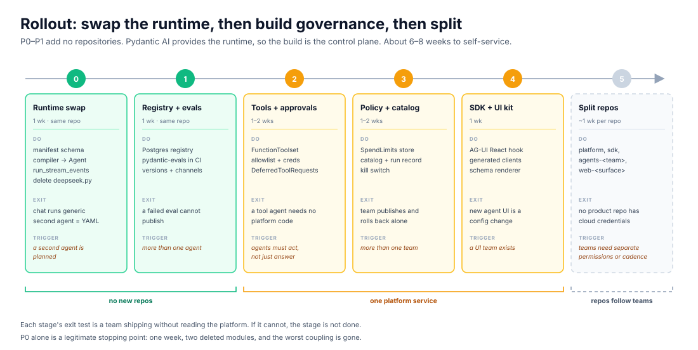
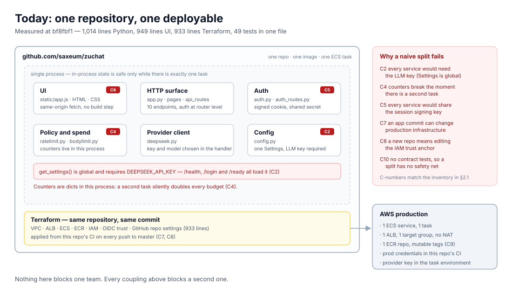

# Decomposing zuchat into a platform

**A proposal for independent team ownership, lower coupling, and safer AI-assisted change.**

Status: draft for review · Date: 2026-11-20 · Scope: repository and deploy topology, not product features

---

## 1. The recommendation in one page

This repository is **one deployable: 1,014 lines of Python, 949 lines of UI, 933 lines of Terraform,
one image, one ECS task, one load balancer, one IAM trust anchor.** Nothing in it is currently
preventing a team from working — but everything in it makes a *second* team, or a second deploy
unit, expensive to add.

The tempting move is to split it into a service per box on the architecture diagram. **That is the
wrong first move here.** At this size it buys autonomy the organisation does not yet need, and pays
for it with distributed auth, contract drift, six CI pipelines, and enough operational surface that
the platform work becomes the product.

**Recommended shape: a federated platform reached in stages.** Extract the three genuinely
cross-cutting things first, leave the product in one repo, and split the product only when a named
trigger fires.

| Stage | What moves | New repo | Why this, why now |
| --- | --- | --- | --- |
| **0. Seams in place** | Per-service settings, provider interface, shared spend store, contract tests | none | Removes the coupling that would otherwise be copied into every new repo |
| **1. Platform** | All Terraform, reusable CI, service template, repo-as-code | `zuchat-platform` | Infra and app currently share one commit and one credential. Highest risk, lowest product risk to fix |
| **2. Contracts** | OpenAPI + SSE + claims schemas, generated clients, `oasdiff` gate | `zuchat-contracts` | A split without this is a split into drift. Makes the boundary machine-checkable |
| **3. AI gateway** | Provider adapters, keys, model allowlist, moderation, spend + audit | `zuchat-model-gateway` | The single biggest AI-safety win: one egress point, one key, one audit trail, per-team budgets |
| **4. Identity** | OIDC login, session → JWT, allowlist | `zuchat-identity` | Only when a *second* service must authenticate users |
| **5. Web and chat** | Static UI to CloudFront/S3; chat orchestration + SSE | `zuchat-web`, `zuchat-chat` | Only when UI or chat cadence diverges from the API |

Stages 1–3 give roughly **80% of the safety and ownership benefit for 20% of the cost**. Stages 4–5
are only justified by evidence, listed as triggers in [§7](#7-when-to-split--and-when-not-to).

**What it buys:** an agent or engineer touching the UI cannot change production IAM; no app service
holds the provider key; a breaking wire change fails CI instead of production; each team owns a repo
whose full contents fit in a review.

**What it costs:** roughly **$20–60/month** more AWS (the number is not the issue) and, more
honestly, **0.5–1 engineer-day per month per extra repo** — 2–3 days after Stage 3, up to 6 with
everything split. Every split also makes one atomic change into two ordered pull requests. That is a real
regression for AI-assisted work, and the reason to split only on a trigger.

**What must not change:** the human merges. Every proposal here keeps merge rights with people,
keeps production apply behind a reviewed environment, and gives agents no credential that can
reach production. A platform that makes deployment self-service without keeping that boundary
would be a downgrade in safety, however tidy the repositories look.

---

## 2. What exists today

Measured on `bf8fbf1` (origin/master, 2026-11-20):

| Dimension | Today | Consequence |
| --- | --- | --- |
| Deployables | 1 | Every change ships as one unit |
| Python in `src/` | 1,014 lines, 13 modules | Small enough to read whole; no internal package boundaries |
| Tests | 737 lines, 49 tests, one file | App-level integration tests; no boundary or contract tests |
| UI | 949 lines static, no build step | Served by the app; same-origin API calls |
| Terraform | 933 lines, 3 roots (`bootstrap`, `ecs`, `github`) | Lives with the app; applies from the app repo's CI |
| Runtime | 1 ECS service, 1 task, 1 ALB target group, no NAT | In-process state is safe only because there is exactly one task |
| Repos | 1 | GitHub permissions, secrets and CI trust are repo-wide |
| Spend controls | In-process counters | Reset on deploy; not shared; break with a second task |
| Provider key | `DEEPSEEK_API_KEY` in the app task | Every service would inherit an LLM credential |

### 2.1 The coupling that actually exists

These are the specific couplings the proposals have to address. Each is a fact about a file, not a
feeling about architecture.

| # | Coupling | Evidence | What it blocks | Severity |
| --- | --- | --- | --- | --- |
| C1 | One composition root imports every feature | `app.py:10-13`, `app.py:58-61` | Any module change edits a shared file; no module can be lifted out without editing it | Low |
| C2 | Config is global and the LLM key is **required** | `config.py:15`; `app.py:19` calls `get_settings()`; `ops_routes.py:30` | Even a service that only does auth or health must carry `DEEPSEEK_API_KEY` | **High** |
| C3 | Spend policy, concurrency and provider I/O share a handler | `api_routes.py:40-169` | Cannot change provider or quota policy without touching the HTTP surface | Medium |
| C4 | Counters are process-local | `ratelimit.py:10-12`, `ratelimit.py:204` (`lru_cache`) | A second task, or a second service, silently breaks every budget | **High** |
| C5 | Auth and app share a signed cookie + `SESSION_SECRET` | `auth.py:53-63`, `app.py:39-46` | A new service must share a bearer signing key, or cannot identify users | **High** |
| C6 | UI hardcodes same-origin `/api` calls | `static/app.js:308`, `static/app.js:355` | UI cannot move origin without CORS, credential and CSRF work | Medium |
| C7 | Infra applies from the app repo on every master push | `.github/workflows/terraform-apply.yml`; `terraform/ecs/*` | An app commit can change production infrastructure; app repo needs AWS write | **High** |
| C8 | Repo identity is hardcoded in the IAM trust anchor | `terraform/ecs/github_actions.tf:11-26` | A new repo cannot deploy without editing the one file that defines trust | **High** |
| C9 | One mutable `:latest` tag is pushed alongside the SHA tag | `Makefile:push`; `terraform/ecs/main.tf:26` | Rollback and "what is running" are ambiguous; digest pinning is impossible | Medium |
| C10 | Tests are app-level only | `tests/test_main.py:1-52` | A split has no safety net; every extraction is unverified until production | **High** |

C2, C4, C5, C7, C8 and C10 are the ones that make a naive split fail. They are also fixable *inside
the current repo*, which is why Stage 0 exists.

---

## 3. What "platform" should mean here

A platform is not a repository count. It is a **paved road** that lets a team ship a service without
designing its build, deploy, identity, observability or repo settings. Five capabilities, each small:

1. **A service template** — `zuchat-platform/templates/service`: Dockerfile, `/health`, `/ready`,
   `/metrics`, OpenTelemetry, `CODEOWNERS`, repo-local `AGENTS.md`, CI that calls a shared workflow.
2. **Reusable CI** — one pinned workflow (`python-service.yml@<sha>`): lock check, lint, tests,
   image build, SBOM, scan, sign, push by digest. A security fix lands once, not per repo.
3. **Terraform modules, not Terraform forks** — `modules/service` (ECS service, target-group rule,
   log group, task role with no secrets by default, alarms), `modules/environment` (VPC, cluster,
   shared ALB), `modules/repo` (branch protection, environments, secret scanning). Environment
   roots (`envs/dev`, `envs/prod`) pin module versions and image digests.
4. **A contract registry** — OpenAPI, SSE frame schema, identity claims. Generated clients;
   breaking-change detection in CI.
5. **An ownership registry** — one `services.yaml` (name, owner, repo, URL, SLO, on-call) that
   generates dashboards, alarms and routing. One file, machine-readable, no prose to rot.

What it must not mean: a platform team that reviews every change, a shared `common` library with one
consumer, or a repo per Python package. Those are the failure modes, not the goal.

---

## 4. Proposal A — Three seams, four repos (recommended first step)

Extract only what is cross-cutting; keep the product together.

[](diagrams/02-target-repos.svg)

| Repo | Owns | Runtime | Holds credentials |
| --- | --- | --- | --- |
| `zuchat-app` (today's repo, renamed) | UI, auth, chat API, quota policy | 1 ECS service | No AWS write, no provider key after Stage 3 |
| `zuchat-platform` | Terraform modules + env roots, reusable CI, templates, repo-as-code | none | **Only** repo with an AWS apply role |
| `zuchat-contracts` | OpenAPI, SSE schema, claims, generated clients, contract tests | published artifact | none |
| `zuchat-model-gateway` | Provider adapters, keys, allowlist, moderation, budgets, audit | 1 ECS service (or Lambda) | Provider key only |

**Why this order.** Platform first removes the shared-commit/shared-credential problem and is
invisible to users. Contracts second is the precondition for any later split — without it, Stage 3
and beyond create drift. Gateway third delivers the AI-safety controls while there is still only
one product team to coordinate with.

**Tradeoffs.**

- *For:* four repos, each with one reason to change; prod credentials in exactly one place; one AI
  egress point; a real contract boundary; ~1 week of infra work, no user-visible change.
- *Against:* the UI, auth and chat still release together — a frontend team would still wait on the
  API. Quota policy still lives in the app, though its state is now shared. Two services add one
  network hop and one more thing to page on.
- *Reversibility:* high. Each repo can be merged back if the boundary proves wrong; contracts and
  the gateway can be in-process libraries first.

---

## 5. Proposal B — Federated platform (the destination, on triggers)

The full split: six repos, four deploy units, one shared ALB with host/path rules.

[](diagrams/03-runtime-and-trust.svg)

| Repo | Deploy unit | Release cadence | Owner | Trigger to create |
| --- | --- | --- | --- | --- |
| `zuchat-web` | CloudFront + S3 | daily | Frontend | UI cadence diverges, or a frontend team exists |
| `zuchat-identity` | ECS service, `/login` `/auth` `/logout` | rarely | Security | A second service must authenticate users |
| `zuchat-chat` | ECS service, `/api/chat*` | daily | Product | Chat must scale or release independently |
| `zuchat-model-gateway` | ECS/Lambda, internal only | weekly | AI platform | Second AI feature, audit requirement, or key consolidation |
| `zuchat-contracts` | none (artifact) | with providers | Platform + API reps | The second deploy unit |
| `zuchat-platform` | none (Terraform) | with infra change | Platform | Now |

**Rules that make it work:**

- **One direction of dependency.** Web → chat → gateway. Identity is called by web only; services
  verify a JWT via JWKS instead of sharing `SESSION_SECRET`. No service imports another's code.
- **Contracts are additive.** SSE frame kinds are never removed, only added; breaking HTTP changes
  mean `/v2`; `oasdiff breaking` runs in every consumer repo.
- **One ALB, many target groups.** No ALB per service: a second ALB is ~$25/month and another TLS
  and DNS surface for no isolation you cannot get from security groups.
- **Shared state is explicit.** Quotas move to DynamoDB (on-demand, conditional writes); identity
  sessions to signed JWTs with short TTL plus refresh; nothing else shares state.
- **Deploy by digest, and the human merges the bump.** App repos publish `repo@sha256:…`; the
  platform environment root pins it. The review of the pinned digest is the review of what runs —
  which preserves the "reviewed object = merged object" invariant across a repo boundary.
- **N-1 compatibility.** A consumer must run against the previous provider version for one release,
  so two repos never need a simultaneous deploy.

**Tradeoffs.**

- *For:* genuine independent release trains; per-team blast radius; per-service IAM and secrets;
  independent scaling; the UI ships without the API.
- *Against:* distributed auth is the hardest part of any split and is where most of the risk sits
  (cookie domain, SameSite, logout revocation, token clock skew). Five CI pipelines, five sets of
  dependency updates, six repos of branch protection. The platform team becomes a bottleneck the
  moment it starts reviewing instead of publishing modules. A cross-repo change is now two PRs with
  an order, which is *worse* for a single AI agent than today's atomic edit.
- *Reversibility:* medium. Once auth is distributed and state is in DynamoDB, merging back is a
  project. Do it for a trigger, not for tidiness.

---

## 6. Proposal C — Monorepo with enforced boundaries (the counterfactual)

Keep one repository; split into `services/` and `packages/` with a uv workspace, path-filtered CI,
`CODEOWNERS`, `import-linter` rules, and one Dockerfile per deploy unit.

**Tradeoffs.**

- *For:* almost all of the *code* decoupling at ~10% of the cost; one atomic cross-cutting change;
  one dependency tree; one place for contract tests; no cross-repo tokens. Best option if the real
  problem is "the code is tangled", not "teams block each other".
- *Against:* GitHub permissions are repo-scoped, so an agent or contractor with write access can
  still touch the deploy workflow, the IAM trust anchor, and every service. That is precisely the
  blast-radius problem AI-assisted work makes urgent. CI concurrency and clone size grow with the
  team; a missing path filter means every push tests everything. One compromised token is all repos.
- *Reversibility:* high, and it is the cheapest way to *practise* the boundaries before paying for
  the repo split. The `services/` layout can be lifted into repos later with `git filter-repo`.

**Recommendation:** treat C as Stage 0's working style, not the destination. Enforce the import
boundaries in the current repo now; cut repos when the triggers in §7 fire.

---

## 7. When to split — and when not to

Every split must name the problem it solves. If no row fires, do not create the repo.

| Split | Trigger (any one) | Exit criteria |
| --- | --- | --- |
| Platform repo | **Always** — infra already owns prod trust and 933 lines | App repo has no AWS role; a plan runs on every infra PR; prod apply needs a human approval |
| Contracts repo | A second deploy unit, or an external consumer of the API | `oasdiff` fails a deliberate breaking change in CI; a generated client compiles |
| Model gateway | Second AI feature/team; audit or retention requirement; key-rotation policy; >1 service calling a provider | Provider key exists in exactly one secret; one audit record per request; a per-team budget is enforced across two tasks |
| Identity | A second service authenticates users; web moves to CloudFront | `SESSION_SECRET` exists in one service; JWKS verification works in a service that never saw it |
| Web | UI release cadence differs, or a frontend team exists | UI deploys without an API deploy; CORS + credentials + CSRF tests pass |
| Chat | Chat must scale independently, or its cadence conflicts with gateway/identity | Chat and gateway release on different days without coordination |

**Do not split:**

- `ratelimit.py` into a service. It is a library plus a store; a quota service is a database with a
  network hop in front of it.
- By layer (`routes/`, `services/`, `models/`) or by endpoint. That is a directory, not a boundary.
- `bodylimit` into a repo. Put it at the edge (ALB/WAF) or copy ten lines into the template.
- A `common`/`shared` repo with one consumer. That is a distributed monolith with extra steps.

---

## 8. Contracts: the seam that makes the rest safe

The contract is five small, versioned things. Write them down once; generate everything else.

| Contract | Consumer | Enforcement |
| --- | --- | --- |
| `POST /api/chat` — `{message: 1..4000}` → `{reply}` | Web, integrations | OpenAPI + `oasdiff breaking` |
| `POST /api/chat/stream` — `data:{"text"}` … `data:[DONE]`, `event:error` | Web | Schema for frame kinds; a recorded stream replayed as a test |
| Errors — `{"detail"}`, 429 + `Retry-After`, 401 + `WWW-Authenticate`, 413 | All | Shared error schema in the spec |
| Identity — `sub`, `email`, `name`, `exp`, `iss`, `aud` | Every service | JWKS + claims test; never share the signing secret |
| Ops — `/health` (no deps), `/ready` (deps), `/metrics` | ALB, platform | Template + platform alarms |

**Compatibility policy:** additive within a major. A new SSE frame kind must be ignorable by an old
client. A removed field is a `/v2`, with the old path served for one release.

**Why this matters more than the repo split:** today one process cannot drift from itself. The
moment there are two deployables, every unchecked assumption between them becomes a production
incident class. Contract tests are the *safety net that replaces the compiler*.

---

## 9. Using AI more safely

Two different questions, usually conflated. Both need answers.

### 9.1 Agents changing this codebase

| Risk today | Why | After |
| --- | --- | --- |
| One commit can change UI, API, quotas, IAM and the deploy gate | Everything is in one repo, one lockfile | Repo-scoped blast radius; platform repo is the only one with cloud write |
| An agent with repo write can edit its own CI | Workflow files sit beside the code | Reusable workflows pinned by SHA + `CODEOWNERS` on `.github/workflows` + org-level required checks |
| An agent can reach production | App repo assumes `zuchat-tf-apply-production` from a reviewed Environment | App repos hold no AWS role at all; apply lives in the platform repo |
| The provider key is reachable from the app task | `DEEPSEEK_API_KEY` in `terraform/ecs/ecs.tf` | Only the gateway's task role can read it |
| Context is the whole product, every time | 2.7k lines in one tree | Per-repo context of 200–800 lines; contracts are the only cross-repo reading |
| Silent contract drift becomes possible after a split | No contract tests today | `oasdiff` + generated clients + consumer tests |
| Two agents edit one working tree | Shared checkout | One repo per team, one worktree per agent, `[warn]` + claim on shared resources |

**The honest cost:** splitting repos makes an AI agent *less* able to make one atomic change. Today
it can fix both sides of a wire format in one commit and one test run. After the split that is two
PRs, a version bump, and an ordering rule. Safety here is bought with coordination, and the
mitigation is contract-first design, not better prompting.

**Non-negotiables:** no agent merges, no agent holds a production credential, no agent moves a
ticket to Done. The current `AGENTS.md` already says this; the platform must not create a
convenience path around it (a bot token, a "deploy" button, an auto-merge queue).

### 9.2 The AI product

Today the app talks to `api.deepseek.com` directly from the request handler, with the key in its own
task definition. Controls are real but local: request rate, concurrency, token budgets, output cap.
Gaps, and what the gateway does about them:

| Gap | Evidence | Gateway control |
| --- | --- | --- |
| Provider key in the product service | `terraform/ecs/ecs.tf` secrets | One secret, one task role, short-lived where possible |
| No model allowlist | `deepseek.py:8`, `deepseek.py:146` (`model="deepseek-chat"`) | Server-side model selection; client cannot choose |
| No prompt/response policy, moderation or PII redaction | none exists | Policy hook at the single egress point; fail-closed decision recorded |
| No audit trail | only `logger.warning` on stream failure | One record per request: actor, model, tokens, latency, decision, trace id |
| Budgets reset on deploy and are per-task | `ratelimit.py:10-12` | Shared store; per-user, per-team and global budgets; survives deploys |
| No egress control | task has open egress | Only the gateway can reach the provider; app services have no internet egress |
| No cost attribution | one global budget | Spend by service/team/key, exported as a metric |

**Constraint to decide explicitly:** whether the gateway fails **open** (serve the request, log a
policy failure) or **closed** (refuse). For a public chat app, closed on safety policy and open on
audit-log failure is defensible; the reverse is not. Write it down.

---

## 10. Cost

Order of magnitude, `ap-southeast-2`, current traffic:

| Item | Monthly |
| --- | --- |
| Additional ECS service (0.5 vCPU / 1 GB, no NAT) | ~$18–25 |
| Shared ALB, extra target group / listener rule | ~$0 (ALB already exists; a new ALB would be ~$25) |
| DynamoDB on-demand quota store | <$1 |
| CloudFront + S3 for the UI | <$1 |
| CloudWatch logs, alarms, dashboards | ~$5 |
| **Runtime total** | **~$25–35/month above today** |

The real number is not AWS. Each extra repo is roughly **0.5–1 engineer-day per month** in
dependency updates, CI maintenance and version coordination: **2–3 days/month** after Stage 3, **up
to 6** at the full shape. State that to the boss plainly; if there is no platform owner, the repos
will rot and the split will be worse than the monolith.

Migration cost, one-off: platform extraction ~3–5 days; contracts ~3 days; gateway ~5–8 days;
identity ~5–10 days (the risky one); web ~3 days; chat ~3 days. Terraform state moves
(`terraform state mv`/`import`) and a weighted target-group cutover are the fiddly parts.

---

## 11. Risks

| Risk | Likelihood | Impact | Mitigation |
| --- | --- | --- | --- |
| Distributed auth breaks login/logout or leaks sessions | Medium | High | Identity issues short-lived JWTs; services verify via JWKS; never share `SESSION_SECRET`; test clock skew, logout, and cross-origin cookies |
| Contract drift between repos | High without controls | High | `oasdiff breaking`, generated clients, recorded SSE replay, N-1 compatibility |
| Deploy ordering incidents | Medium | Medium | Additive contracts, deploy provider before consumer, canary via weighted target group |
| Quota overshoot after moving to a shared store | High (small) | Medium (cost) | Accept small overshoot; conditional writes; alert on spend delta; keep per-user gate at the edge |
| Platform team becomes the bottleneck | High | High | Publish versioned modules and templates; never review app changes; app teams own their CI config |
| Repo sprawl outruns ownership | Medium | High | No repo without an owner and a trigger in §7; `services.yaml` is the registry; archive on dormancy |
| AI agents coordinate worse across repos | High | Medium | Contract-first, one worktree per agent, explicit handoff messages; accept N-1 window |
| Split is done for the diagram, not a problem | Medium | High | Each stage has an exit criterion; stopping after Stage 2 is a valid outcome |

---

## 12. Decisions needed

| # | Decision | Recommendation |
| --- | --- | --- |
| D1 | Is this anticipatory, or are there two teams today? | If anticipatory: stop after Stage 2. Do not cut identity/web/chat |
| D2 | Who owns the platform (0.5 FTE minimum)? | Name them before Stage 1, or do not start Stage 1 |
| D3 | Is provider spend/audit a compliance requirement? | Yes → gateway in Stage 3; no → still do it for key consolidation, later |
| D4 | Does the UI need an independent release cadence? | No → keep web in `zuchat-app`; revisit when a frontend team exists |
| D5 | Autonomy vs consistency | Consistency first: shared template and contract gates, team autonomy inside a repo |
| D6 | Fail-open or fail-closed at the gateway | Closed for safety policy, open for audit-log failure; recorded in an ADR |

---

## 13. Staged plan (what to do first)

[](diagrams/04-roadmap.svg)

**Stage 0 — seams, no new repos (1 week).** Split `Settings` per subsystem so the LLM key is not
required by `/health` or auth; introduce a `Provider` protocol in front of `deepseek.py`; move
counters behind a `CounterStore` interface with an in-memory implementation; add the OpenAPI spec as
a checked-in artefact and a contract test that replays a recorded SSE stream; add `import-linter`
rules for the intended module boundaries; make ECR immutable and stop pushing `:latest`.

**Stage 1 — platform (3–5 days).** Create `zuchat-platform`; move `terraform/**` (except
`bootstrap`, applied once by a human) and reusable workflows; parameterise the GitHub OIDC subject
per repo (C8) instead of the hardcoded `saxeum/zuchat`; give app repos no AWS role; deploy by digest
through a reviewed environment bump.

**Stage 2 — contracts (3 days).** Create `zuchat-contracts`; publish the spec from CI; generate a TS
client for the UI; run `oasdiff breaking` in the app repo. **This is a legitimate stopping point.**

**Stage 3 — model gateway (5–8 days).** Only if D3 or a second AI surface is real. Move the key,
model allowlist, token accounting, audit record and policy hook; point `deepseek.py` at the gateway
behind the Stage 0 `Provider` interface.

**Stages 4–5 — identity, web, chat.** Only on a trigger from §7, and identity first: web on another
origin cannot work until a token can be verified without the signing secret.

---

## Appendix A — Evidence

[](diagrams/01-current-state.svg)

Observed at `bf8fbf1`. These are the four claims the whole proposal rests on.

Counters are process-local, so a second task doubles every budget:

```
grep -n 'from functools import lru_cache\|_hits:\|_held:' src/zuchat/ratelimit.py
```

```
20:from functools import lru_cache
59:        self._hits: dict[str, deque[float]] = {}
106:        self._held: dict[str, deque[float]] = {}
```

The LLM key gates application startup, not just the chat route:

```
grep -n '^    get_settings()' src/zuchat/app.py
```

```
19:    get_settings()
```

Infrastructure is applied by the same repository's pipeline, from a reviewed Environment:

```
grep -n 'environment: production\|terraform apply' .github/workflows/terraform-apply.yml
```

```
33:    environment: production
78:          terraform apply -auto-approve -input=false
```

The deploy trust anchor names one repository, so a new repo means editing this file:

```
grep -n 'github_repo  = \|github_subject_prefix = "repo' terraform/ecs/github_actions.tf
```

```
11:  github_repo  = "saxeum/zuchat"
22:  github_subject_prefix = "repo:saxeum@343752441/zuchat@1457250024"
```

## Appendix B — Sources

- `README.md` — runtime, limits, endpoints, bootstrap
- `src/zuchat/{app,config,auth,api_routes,ratelimit,deepseek}.py` — coupling evidence
- `terraform/ecs/{ecs,iam,github_actions,versions}.tf` — deploy and trust topology
- `.github/workflows/{ci,docker,terraform-plan,terraform-apply}.yml` — change and deploy path
- `tests/test_main.py` — current safety net
- Repo rules: `AGENTS.md` (human merges, invariant 5: nothing applied outside the pipeline)
