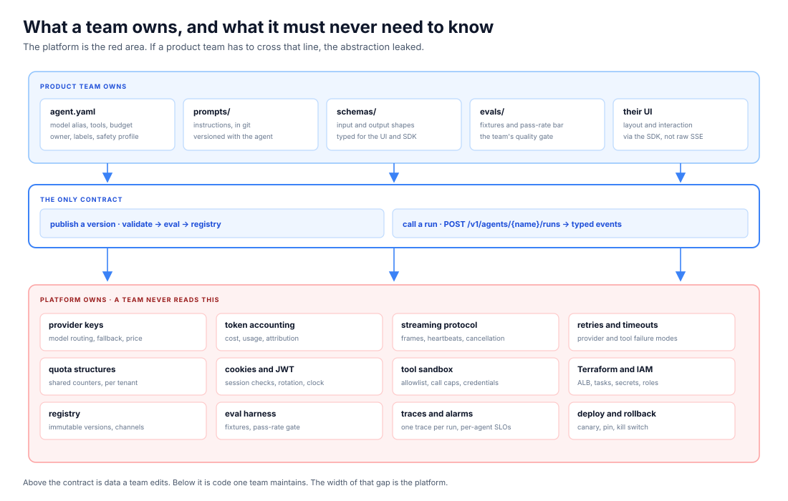
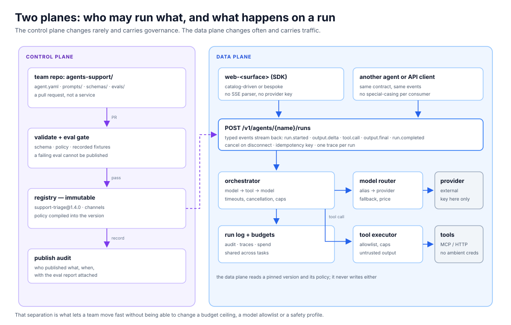
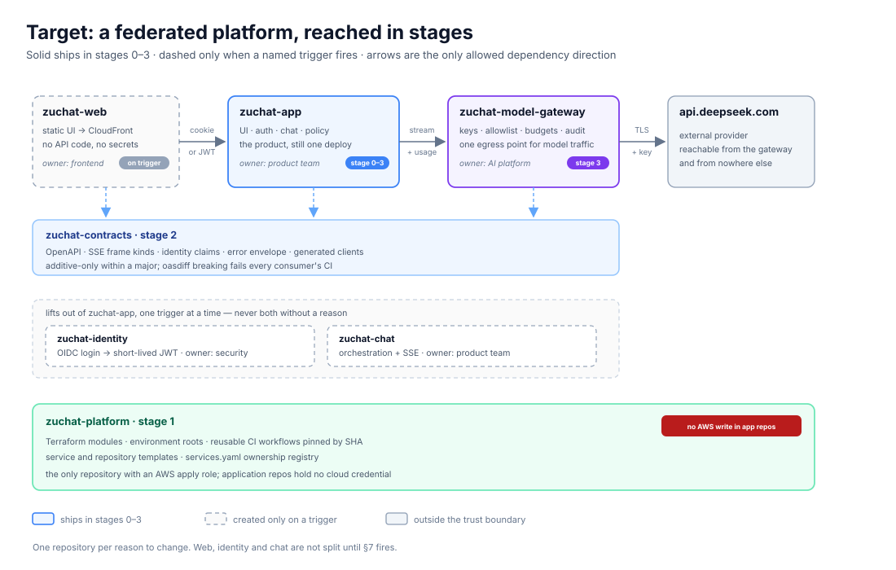

# zuchat as an agent platform, on Pydantic AI

**Adopt the runtime. Build the governance layer. Repositories follow teams.**

Status: third draft · Date: 2026-11-20 · Supersedes the framework-agnostic draft
Assumes: `pydantic-ai` 2.71 as the runtime core, `pydantic-evals` for the quality gate

---

## 0. What changed

The previous draft described the right shape — an agent is a versioned artifact, a run is one typed
contract, product teams own manifests — but left every piece to be built.

Reading Pydantic AI changes the build list materially:

- **Agent definition, tools, streaming, retries, provider clients, usage limits, spend limits,
  conversation persistence, approvals, tracing, evals and UI event protocols already exist** as
  libraries. Rebuilding them would be the second mechanism for a solved problem.
- **What does not exist** is everything organizational: an immutable registry with channels, a
  compiler that turns a *restricted* manifest into an agent, a catalog your UIs can discover, tenant
  policy, and the publish gate. That is the platform.

So the split is now explicit: **adopt the runtime, build the control plane.** The interesting design
work moves from "how do we call a model and stream it" to "what are teams allowed to declare, and
what can they not reach".

> One line: Pydantic AI is the engine. zuchat-platform is the keys, the odometer, the registration
> papers, and the rule that only licensed drivers get them.

### 0.1 The starting point

There is no agent in the codebase. `grep -ri agent src/zuchat` returns **zero** matches.
`deepseek.py:49` sends exactly one user message, `api_routes.py:29` accepts `message: str`, and
`static/app.js:355` parses the SSE stream itself. So "ship a new agent" today means touching:

| # | File | Why |
| --- | --- | --- |
| 1 | `api_routes.py` | new route or branch, plus quota wiring |
| 2 | `deepseek.py` | prompt, model, tools, message shape |
| 3 | `config.py` | model, limits and budgets |
| 4 | `ratelimit.py` | budget keys, if metered differently |
| 5 | `static/app.js` + HTML/CSS | the UI and its own stream parser |
| 6 | `terraform/ecs/ecs.tf` + `variables.tf` | every new setting as an env entry |
| 7 | `tests/test_main.py` | app-level tests that import everything |
| 8 | `app.py` | router registration |

**Eight files, five subsystems, one infra apply.** Every team must hold the whole runtime in its
head, and every change conflicts with every other team's.

[](diagrams/01-current-state.svg)

Pydantic AI removes roughly half of that list: the provider client, the stream format, the token
counting and the retries. The manifest, registry and policy layer remove the rest.

---

## 1. Adopt vs build

| Concern | Adopt — Pydantic AI | Build — `zuchat-platform` |
| --- | --- | --- |
| Agent object | `Agent(model, deps_type, output_type, instructions, toolsets, capabilities)` | manifest schema + compiler |
| Declarative definition | `Agent.from_spec` / `from_file` (YAML/JSON) | **our restricted manifest** — never their spec verbatim |
| Model access | `deepseek:` provider, `OpenAIChatModel`, fallback, many providers | alias table, per-tenant routing, pinned resolution |
| Streaming | `agent.run_stream_events()` → `AgentStreamEvent` … `AgentRunResultEvent` | run envelope, run record, version in the trace |
| UI protocol | `AGUIAdapter` / `VercelAIAdapter` (`dispatch_request`) | catalog, version pinning, SDK |
| Tools | `FunctionToolset`, `Toolset`, MCP | tool registry, allowlist, per-tenant credentials |
| Human approval | `DeferredToolRequests` / `DeferredToolResults`, deferred tools | approval UI, resume endpoint, audit |
| Per-run cost | `UsageLimits(output_tokens_limit=, request_limit=)` | per-agent caps compiled into the version |
| Period spend | `SpendLimits(Budget(usd, window), store=…)` over Postgres/Redis (harness, 0.x) | one budget namespace per tenant, policy bounds, alerts |
| Conversation state | `Conversation`, `ConversationTypeAdapter`, `conversation=` | tenant schema, retention, run log |
| Evals | `pydantic_evals` `Dataset`, `Case`, `evaluate_sync` | CI gate, publish record, canary |
| Traces | OpenTelemetry instrumentation; optional Logfire | dashboards, SLOs, audit export |
| Deploy | none — it runs in your process | ECS service, infra, secrets |
| **Registry, versions, channels** | **none** | **ours** |
| **Catalog for UIs** | **none** | **ours** |
| **Tenant identity and policy** | **none** | **ours** |
| **Publish gate and ownership** | **none** | **ours** |

Pydantic are explicit about the boundary: *"open-source, MIT-licensed Python packages that run in
your own process… there is no Pydantic-hosted agent runtime."*
That is the correct vendor posture for us — it runs on ECS, next to the existing FastAPI app.

---

## 2. The unit of work: our manifest, not a Pydantic AI spec

Pydantic AI's own spec format is powerful enough to be code. Their documentation warns that a spec
*"has the same authority as the code that builds the agent"*, can name **arbitrary MCP server URLs,
including localhost and private addresses**, and runs with the machine's network access.

Self-service YAML that can name any endpoint is not a platform, it is an SSRF primitive with a
schema. So zuchat defines its **own, smaller schema**, and the platform compiles it:

```yaml
# agents/triage/agent.yaml
apiVersion: zuchat/v1
kind: Agent
metadata:
  name: triage
  owner: team-support
  labels: {surface: web, tier: public}
spec:
  model:
    alias: standard              # never a provider model string
  instructions: prompts/system.md
  input:  {schema: schemas/input.json}
  output: {schema: schemas/output.json, format: json}
  tools: [kb.search, ticket.read]   # registry names, never URLs
  budget:
    perRun: {usd: 0.05, tokens: 8000}
    perDay: {usd: 5}
  safety:
    profile: public-chat
    approvals: [ticket.write]
  evals:
    dataset: evals/triage.yaml
    minPassRate: 0.95
```

Deliberate omissions, each for a reason:

| Not in the manifest | Why |
| --- | --- |
| `model:` provider string | teams must not pick or pin a provider; alias resolution is a platform change |
| `capabilities:` passthrough | a capability can add tools and network access; only the platform adds those |
| MCP URLs / tool endpoints | the tool registry resolves names; no team-supplied egress |
| arbitrary `model_settings` | temperature and token caps are policy, bounded by the platform |
| Python | if it is not a prompt, a schema or a registered tool, it is a platform feature request |

Everything a team writes is data the platform can validate, compile and refuse.

---

## 3. Compiling a manifest into an agent

The compiler is the only place that turns data into a Pydantic AI `Agent`. It is deterministic: the
same manifest plus policy produces the same compiled object, and its digest is what gets pinned.

```python
from decimal import Decimal
from typing import Union

from pydantic_ai import Agent, DeferredToolRequests
from pydantic_ai_harness import SpendLimits
from pydantic_ai_harness.spend_limits import Budget, PostgresSpendStore

from zuchat.policy import Audit, Safety, alias_to_model
from zuchat.tools import ToolRegistry

def compile_agent(v: AgentVersion) -> Agent[RunDeps, Output]:
    spec = Manifest.model_validate_json(v.manifest_json)

    return Agent(
        # resolved and pinned at publish time, not per request
        model=alias_to_model(v.resolved_model),
        deps_type=RunDeps,
        output_type=Union[spec.output_type(), DeferredToolRequests],
        instructions=load_prompt(v),
        toolsets=[ToolRegistry.subset(spec.tools, tenant=v.tenant)],
        capabilities=[
            SpendLimits(
                budgets=[
                    Budget(usd=Decimal(spec.budget.per_day_usd), window="day"),
                ],
                # one namespace per tenant; a Postgres store underneath
                store=budget_store(v.tenant),
            ),
            Audit(v.name, v.version, v.digest),
            Safety(spec.safety),
        ],
    )
```

Two details that matter more than they look:

- **The alias is resolved at publish time and stored on the version.** If `standard` later points at
  a new provider model, published agents do not silently change behaviour. Upgrading a model is a
  new version, with evals and a canary.
- **`DeferredToolRequests` is in `output_type`** whenever an agent has approval-gated tools. A run can
  therefore end *interrupted* rather than complete; the run contract has a state for that, and the
  UI needs to render it.

---

## 4. The two contracts

[](diagrams/05-abstraction-layers.svg)

### 4.1 Publish (control)

```
manifest + prompts + schemas + evals  →  validate → eval → registry (immutable)
```

Validation is ours; evaluation is `pydantic_evals`:

```python
from pydantic_evals import Dataset
dataset = Dataset.from_file("evals/triage.yaml")
report = dataset.evaluate_sync(lambda case: run_once(case.inputs))
assert_pass_rate(report, spec.evals.min_pass_rate)   # our gate over their report
```

The publish is a pull request a human merges. On merge, CI writes an immutable row: name, version,
manifest digest, **resolved model**, compiled policy, eval report, author, timestamp. A failing eval
cannot produce a row.

### 4.2 Run (data)

```
POST /v1/agents/{name}/runs
{ "input": {...}, "version": "stable" | "1.4.0", "stream": true }
```

Internally, one endpoint over one compiled agent:

```python
async with agent.run_stream_events(
    payload.input,
    deps=deps,                       # user, tenant, agent, run_id
    usage_limits=UsageLimits(...),   # per-run backstop
    conversation=await store.load(...),  # Conversation
) as events:
    async for event in events:
        yield envelope(event)        # AgentStreamEvent -> our typed frames
```

| Our frame | Source | Why a UI needs it |
| --- | --- | --- |
| `run.started` | run id, agent, version, digest, trace id | provenance and support |
| `output.delta` | `PartStartEvent` / `PartDeltaEvent` | stream text |
| `tool.call` / `tool.result` | tool events | show "searching…", surface failures |
| `run.interrupted` | `DeferredToolRequests` | approval needed; resume with a run id |
| `output.final` | `AgentRunResultEvent` | validated structured result |
| `run.completed` | `RunUsage` | tokens, cost, finish reason |
| `run.failed` | exception class, retryable | retry or explain |

We do **not** invent a new wire format for browsers: the gateway exposes **AG-UI** (and optionally
Vercel AI) through Pydantic AI's `UIAdapter`. Our envelope adds `version` and `digest` to the start
frame, because "which agent version answered" is a platform question the framework does not ask.
Anything beyond that is a thin mapping, not a protocol.

### 4.3 Discovery: how a new UI consumes agents it has never seen

`GET /v1/agents?label=surface:web` returns published versions with their JSON Schemas. That is what
lets a surface render a new agent without new frontend code:

```ts
const agents = await client.agents.list({ label: "surface:web" });
const run = client.runs.stream({ agent: "triage", version: "stable", input });
for await (const ev of run) {
  if (ev.type === "output.delta") append(ev.text);
  if (ev.type === "tool.call") showTool(ev.name, ev.status);
  if (ev.type === "run.interrupted") showApproval(ev.pending);
}
```

A catalog-driven page renders inputs from `input.schema` and needs no per-agent code. A bespoke
surface uses the same client. Both stop at the contract.

---

## 5. What the platform is, concretely

[](diagrams/06-control-data-plane.svg)

**Control plane** — thin, changes rarely:

- manifest schema and validator (ours)
- eval gate (`pydantic_evals` + our CI workflow)
- registry: immutable versions, digests, resolved models, channels
- policy compiler: budgets, safety profile, tool allowlist, tenant limits
- catalog API

**Data plane** — `zuchat-platform`, one FastAPI service on ECS:

- run gateway: auth, tenant resolution, version/channel lookup, envelope
- compiled-agent cache keyed by digest
- `RunDeps`: user, tenant, agent, run id, policy snapshot
- tool registry (Pydantic AI `FunctionToolset`s per tool, credentials injected per tenant)
- `SpendLimits` over Postgres (or Redis) — **the fix for process-local counters**
- `Conversation` store (Postgres), run record, OTel traces
- approval resume endpoint for deferred tool calls

**SDK** — schemas + generated clients + React streaming hooks, built on AG-UI types.

Note what is *not* on that list: an orchestrator loop, a streaming protocol, a provider client, a
retry policy, a token counter. Pydantic AI owns those. That is roughly two-thirds of the previous
draft's build cost removed.

---

## 6. Repositories follow teams, not layers

[](diagrams/02-target-repos.svg)

| Repo | Contains | Owner | Why a repo |
| --- | --- | --- | --- |
| `zuchat-platform` | gateway, registry, compiler, policy, toolsets, infra | platform | only repo with cloud credentials and provider keys |
| `zuchat-sdk` | manifest + event schemas, TS/Python clients, React hooks | platform + DX | versioned, published |
| `agents-<team>` | manifests, prompts, input/output schemas, eval datasets | product team | separate permissions and on-call, when true |
| `web-<surface>` | product UI on the SDK | frontend | separate cadence, when true |

**Features are directories; repositories are teams.** Adding an agent is a manifest directory and a
PR. Never a new repo, never a Terraform change, never a provider key.

That also settles the earlier drafts' extra repos:

| Earlier proposal | Now |
| --- | --- |
| `zuchat-contracts` | the `zuchat-sdk` package |
| `zuchat-identity` | a capability in `zuchat-platform` until a second product verifies users |
| `zuchat-model-gateway` | the data plane of `zuchat-platform`; Pydantic AI is the router |
| `zuchat-web` per surface | only when a surface has its own team and cadence |

---

## 7. What happens to today's code

| Today | Becomes | Net |
| --- | --- | --- |
| `deepseek.py` (199 lines) | `pydantic_ai` DeepSeek provider + alias table | **deleted** |
| `ratelimit.py` (223 lines) | `UsageLimits` per run + `SpendLimits` over Postgres | **deleted** |
| `api_routes.py` chat + `_events` | run gateway + event envelope | ~40 lines |
| `bodylimit.py` | stays at the edge; ALB/WAF cap | unchanged |
| `config.py` | platform settings, alias table, policy bounds | grows slightly |
| `auth.py` | user identity + `RunDeps.tenant` | unchanged |
| `static/app.js` (392 lines) | SDK + AG-UI streaming hook | **deleted** |
| `tests/test_main.py` | `TestModel` unit tests + per-agent eval datasets | split |
| `terraform/**` (933 lines) | platform repo | moved |

The aesthetic point: the two files most responsible for coupling — the provider client and the
in-process limiter — disappear entirely, because they were the parts of the platform Pydantic AI
already ships.

---

## 8. Tradeoffs

| # | Tension | Cost | Decision |
| --- | --- | --- | --- |
| T1 | Framework coupling | agent semantics, event names and upgrade cadence are Pydantic's; a 3.x is their call | pin minor, own the adapter layer, keep manifests independent |
| T2 | `pydantic-ai-harness` is 0.x | `SpendLimits` may change between minor releases | pin exactly; wrap behind our `BudgetPolicy` so a break is one file |
| T3 | Their spec is code-equivalent | raw `from_spec` from a team repo is an SSRF and privilege boundary hole | our restricted schema; never load untrusted specs |
| T4 | AG-UI lock-in | the browser protocol is theirs, not ours | acceptable; it is the standard frontend frameworks speak. Add only a version/digest envelope |
| T5 | No hosted runtime | we operate the gateway: HA, streaming, cancellation, on-call | already true today on ECS; this does not add a vendor |
| T6 | Hosted Gateway / Logfire | convenience and cost caps, but traces leave the account | default to direct DeepSeek key + our OTel; revisit for multi-provider failover |
| T7 | Alias drift | a platform model change could silently alter every agent | resolve at publish, pin on the version, canary new versions |
| T8 | Eval cost | real-model evals spend money on every PR | budget per eval run with `UsageLimits`; run on label, not every push |
| T9 | Registry still ours | versions, channels, rollback, audit are bespoke | that is the deliverable; it is ~1,500 lines, not a platform team |
| T10 | Declarative ceiling | some agents need behaviour that is not a prompt or a tool | tools are the extension point; anything else is a platform change |

---

## 9. Failure modes

| Failure | Looks like | Countermeasure |
| --- | --- | --- |
| Raw spec passthrough | a team YAML names `mcp://169.254.169.254` | restricted schema; tool names only; validate and refuse |
| YAML PhD | manifest grows conditionals and templating | manifest stays data; new behaviour is a registered tool |
| Alias drift | model swap changes every agent's behaviour overnight | resolved+pinned at publish; eval gate; canary |
| Harness breakage | a 0.x bump changes `SpendLimits` | pin exact; adapter class; CI upgrade test |
| Eval flake | gate bypassed because it fails randomly | thresholds, quarantine, recorded datasets, flake rate metric |
| Gateway as god service | auth, tools, state, deploys, UI all in one box | one deploy unit, but modules with tests; split only on load evidence |
| Registry theatre | rows exist, but deploys bypass them | publish only through CI; no manual writes; registry is the only resolver |
| Platform bottleneck | platform team reviews every prompt | they publish policy and evals; they do not approve prompts |

---

## 10. Plan

[](diagrams/04-roadmap.svg)

[](diagrams/07-golden-path.svg)

| Stage | Work | Exit test |
| --- | --- | --- |
| **P0 — Runtime swap** (1 wk) | manifest schema + compiler; `compile_agent`; one run endpoint over `run_stream_events`; AG-UI envelope; port chat to `chat@1`; delete `deepseek.py` and `ratelimit.py` | existing chat works through the generic path; a second agent ships as a manifest only |
| **P1 — Registry + eval gate** (1 wk) | Postgres registry; `pydantic_evals` in CI; immutable versions; channels | a failed eval cannot publish; rollback is a channel pin |
| **P2 — Tools + approvals** (1–2 wks) | `FunctionToolset` registry; allowlist; credentials per tenant; `DeferredToolRequests` + resume | a tool-using agent ships with no platform code; a write needs approval |
| **P3 — Policy + catalog** (1–2 wks) | `SpendLimits` per tenant, audit records, `GET /v1/agents`, kill switch | a team publishes and rolls back alone; catalog renders it |
| **P4 — SDK + UI kit** (1 wk) | generated clients, AG-UI React hook, schema renderer | a new agent's UI is a config change |
| **P5 — Split repos** (1 wk each) | platform, sdk, agents-`<team>`, web-`<surface>`; infra moves | no product repo has a cloud credential |

**Total to self-service: ~6–8 engineer-weeks**, down from 9–14 in the framework-agnostic draft,
because the runtime is adopted rather than written.

**Parallel, 3–5 days:** move Terraform out of the app repo, stop pushing `:latest`, remove the AWS
apply role from the app repo. Credential blast radius, independent of P0.

Break-even: if an agent costs 1–2 weeks of core work today, **4–6 agents** pays back the platform
within the year. Fewer than two: do P0 only.

---

## 11. Using AI more safely

The platform is now a **narrow** surface, which is what makes agents safe to run on it.

| Risk | Control |
| --- | --- |
| A team manifest reaches an internal address | restricted schema; no URLs; tool registry only |
| A team adds an unvetted capability | no capability passthrough; platform adds `SpendLimits`, `Safety`, `Audit` |
| Provider key in product code | key only in the platform task role; product repos hold none |
| Budget reset on deploy | `SpendLimits` over Postgres/Redis, per tenant and per agent |
| Runaway loop | `UsageLimits(request_limit=, output_tokens_limit=)` per run |
| Destructive tool call | `DeferredToolRequests`; approval before the run resumes |
| Bad prompt reaches everyone | eval gate, canary channel, digest pin, kill switch |
| Prompt injection through tool output | toolsets return untrusted data; approvals for writes; no ambient credentials |
| No audit | one run record + OTel trace: actor, tenant, agent, version, digest, tokens, cost, tool calls |
| An agent editing the codebase | `agents-<team>` contains manifests and evals; nothing it writes can reach infra |

[](diagrams/03-runtime-and-trust.svg)

And the org invariants hold: a human merges, production apply stays behind a reviewed environment,
and no product repository has a credential that can change production.

---

## 12. Cost and decisions

| Item | One-off | Ongoing |
| --- | --- | --- |
| P0–P3 | ~4–6 engineer-weeks | ~0.5 FTE (owner, evals, tools, on-call) |
| P4 SDK + UI kit | ~1 week | same owner |
| P5 repo split | ~1 week per repo | ~0.5–1 day per repo per month |
| Runtime | — | ~$25–60/month above today |

| # | Decision | Recommendation |
| --- | --- | --- |
| D1 | How many agents in 12 months? | <2 → P0 only; 2–3 → P0–P1; 4–6 → P0–P3; 7+ → all |
| D2 | Who owns the platform (0.5 FTE)? | name them before P0, or do P0 only |
| D3 | Direct DeepSeek key, or Pydantic AI Gateway? | direct key + our OTel first; Gateway when multi-provider failover is real |
| D4 | Logfire, or OTel to existing tooling? | OTel first; Logfire only if trace UX is the bottleneck and data policy allows |
| D5 | Postgres or Redis for spend? | Postgres — we already need it for the registry, and it is one fewer service |
| D6 | Accept `pydantic-ai-harness` 0.x for `SpendLimits`? | yes, pinned and wrapped; otherwise write the one capability ourselves |
| D7 | AG-UI or Vercel AI for browsers? | AG-UI — it is the more general protocol and both adapters exist |

---

## Appendix A — Couplings this design removes

| # | Coupling | Evidence | How it goes away |
| --- | --- | --- | --- |
| C1 | One composition root imports every feature | `app.py:10-13`, `:58-61` | one run router; agents are data |
| C2 | Config is global and the LLM key is required | `config.py:15`; `app.py:19`; `ops_routes.py:30` | key lives in the platform; `RunDeps` carries the rest |
| C3 | Spend policy and provider I/O share a handler | `api_routes.py:40-169` | Pydantic AI runtime + policy capabilities |
| C4 | Counters are process-local | `ratelimit.py:10-12`, `:204` | `SpendLimits` with a Postgres store |
| C5 | Auth and app share a signed cookie | `auth.py:53-63`, `app.py:39-46` | identity stays at the edge; `RunDeps.tenant` downstream |
| C6 | UI hardcodes same-origin `/api` calls | `static/app.js:308`, `:355` | SDK + AG-UI adapter |
| C7 | Infra applies from the app repo | `terraform-apply.yml`; `terraform/ecs/*` | infra moves to the platform repo |
| C8 | Repo identity hardcoded in IAM trust | `github_actions.tf:11-26` | parameterised per environment |
| C9 | Mutable `:latest` alongside the SHA tag | `Makefile:push`; `main.tf:26` | digest pinning; immutable publishes |
| C10 | Tests are app-level only | `tests/test_main.py:1-52` | `TestModel` units + per-agent evals |

## Appendix B — Evidence

Observed at `bf8fbf1`.

There is no agent in the code: one user message, a string request, no tools or history.

```
grep -n '"messages"\|class ChatRequest\|message: str' src/zuchat/deepseek.py src/zuchat/api_routes.py
```

```
src/zuchat/deepseek.py:41:    message: str,
src/zuchat/deepseek.py:49:        "messages": [{"role": "user", "content": message}],
src/zuchat/deepseek.py:145:    message: str,
src/zuchat/deepseek.py:173:    message: str,
src/zuchat/api_routes.py:26:class ChatRequest(BaseModel):
src/zuchat/api_routes.py:29:    message: str = Field(min_length=1, max_length=4000)
src/zuchat/api_routes.py:132:def _events(email: str, api_key: str, message: str) -> Iterator[str]:
```

Counters are process-local, so a second task doubles every budget:

```
grep -n 'from functools import lru_cache\|_hits:\|_held:' src/zuchat/ratelimit.py
```

```
20:from functools import lru_cache
59:        self._hits: dict[str, deque[float]] = {}
106:        self._held: dict[str, deque[float]] = {}
```

The LLM key gates application startup, not just the chat route:

```
grep -n '^    get_settings()' src/zuchat/app.py
```

```
19:    get_settings()
```

## Appendix C — Sources

Versions read on 2026-11-20: `pydantic-ai` 2.71.0, `pydantic-evals` 2.71.0, `google-adk` 2.15.0.

| Topic | Page |
| --- | --- |
| Agents, `run_stream_events`, `UsageLimits` | `pydantic.dev/docs/ai/core-concepts/agents/` |
| Agent Specs (`from_file`, `from_spec`) | `pydantic.dev/docs/ai/core-concepts/agent-spec/` |
| Dependencies (`deps_type`, `RunContext`) | `pydantic.dev/docs/ai/core-concepts/dependencies/` |
| Output and deferred approvals | `pydantic.dev/docs/ai/core-concepts/output/` |
| Conversation persistence | `pydantic.dev/docs/ai/core-concepts/persistence/` |
| Toolsets | `pydantic.dev/docs/ai/tools-toolsets/toolsets/` |
| Deferred tools / approvals | `pydantic.dev/docs/ai/tools-toolsets/deferred-tools/` |
| Capabilities and hooks | `pydantic.dev/docs/ai/capabilities/overview/` |
| Spend limits and stores | `pydantic.dev/docs/ai/harness/spend/` |
| Evals | `pydantic.dev/docs/ai/evals/evals/` |
| UI event streams (AG-UI, Vercel) | `pydantic.dev/docs/ai/integrations/ui/overview/` |
| Production / no hosted runtime | `pydantic.dev/docs/ai/production/` |
| DeepSeek provider | `pydantic.dev/docs/ai/models/deepseek/` |
| ADK (rejected: GCP-shaped) | `adk.dev/` |
