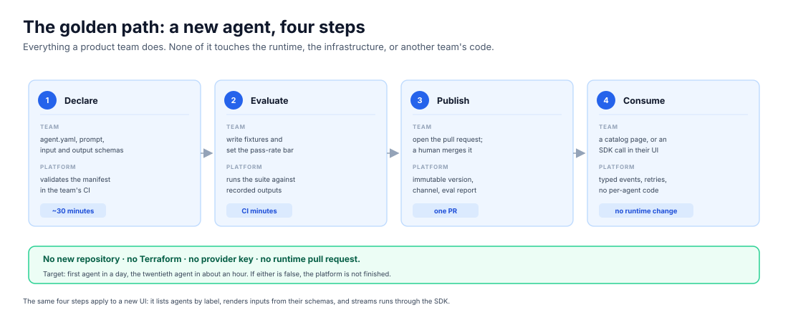
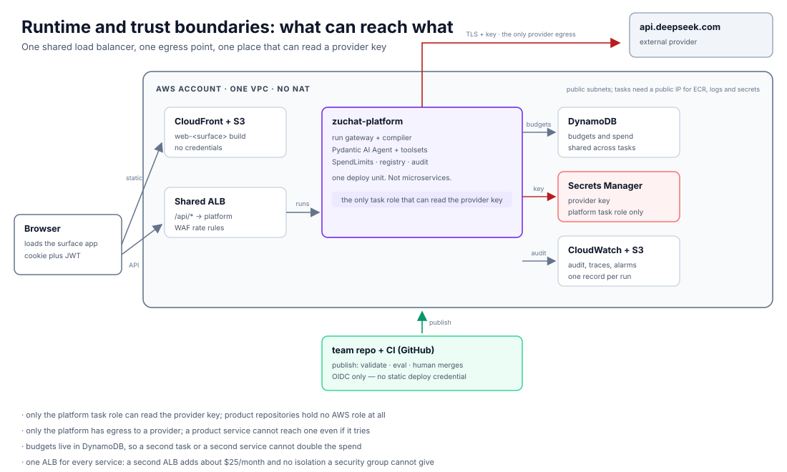

# zuchat as an agent platform

**What product teams own, what the platform hides, and why splitting repositories is the last step.**

Status: second draft · Date: 2026-11-20 · Replaces the repo-split-first recommendation

---

## 0. What changed, and why

The first draft answered "how do we split this into repos". That is a **delivery platform**: teams
deploy independently, but every team still has to understand the runtime to ship anything.

It does not answer the real problem. A product team planning a new agent — or a new UI that
consumes agents — still has to know how the provider is called, how streaming frames are shaped,
where quotas live, how sessions are signed, and how a model choice reaches production. **Splitting
that into more repositories multiplies the number of things they must understand.**

The correction, in one line:

> **A platform is the set of things a product team does not need to know.**

Repositories are a consequence of team boundaries. They are not the boundary itself. **The boundary
is a contract**: a declarative agent definition, one run API, one SDK. Until that exists, no amount
of repo splitting produces a platform — it produces a distributed monolith with more checkout
steps.

The order therefore inverts: build the agent abstraction and its contracts **inside the current
repo**, prove it with a team that did not write it, and split repositories only where teams and
cadence actually differ.

---

## 1. The test: can a new team ship without reading the core?

### 1.1 What adding an agent costs today

There is no agent in the codebase. `grep -ri agent src/zuchat` returns **zero** matches. What exists
is a single chat call:

- `deepseek.py:49` sends exactly `messages: [{"role": "user", "content": message}]` — no system
  prompt, no tools, no history.
- `api_routes.py:29` accepts `message: str` (max 4,000 chars) — the API surface is a string, not a
  typed agent input.
- `static/app.js:355` parses the SSE stream itself, against one hardcoded endpoint.

So "ship a new agent" today means changing all of this:

| # | File | Why it must change |
| --- | --- | --- |
| 1 | `api_routes.py` | new route, or a branch inside the chat handler, plus quota wiring |
| 2 | `deepseek.py` | system prompt / tools / model choice / message shape |
| 3 | `config.py` | model, limits and budget settings |
| 4 | `ratelimit.py` | budget keys, if the agent is metered differently |
| 5 | `static/app.js` + HTML/CSS | the UI, its own stream parser, its own error handling |
| 6 | `terraform/ecs/ecs.tf` + `variables.tf` | every new settings value as a task environment entry |
| 7 | `tests/test_main.py` | app-level tests that import the whole app |
| 8 | `app.py` | router registration, if it is a new module |

**Eight files, five subsystems, one infra apply.** Every product team must hold the whole runtime in
its head, and every change is a merge conflict with every other team. That is the tangle.

[](diagrams/01-current-state.svg)

### 1.2 Why splitting repos does not fix it

After the split in the previous draft, the same team must now also understand: which repo the
change belongs in, how the contract repo versions, whether gateway and UI pins agree, and how two
pull requests order. The knowledge requirement went *up*, and the number of people who can break
each other went *up* with it.

The tangle is not caused by co-location. It is caused by **the absence of an abstraction**: the
unit of extension today is "edit the core", so the core must be understood to extend it.

### 1.3 The test this report is written against

> A team that has never seen this codebase ships an agent and its UI, touching **zero files in the
> platform repository**, and can name the three things it had to learn: the manifest schema, the run
> event stream, and how to get a user token.

Two measurements, both cheap to run every quarter:

| Measure | Today | Target |
| --- | --- | --- |
| Platform source files a new team must read | ~13 (the package) + Terraform | **0** |
| Time to first agent, including UI | 1–2 weeks of core work | **1 day** |
| Time for the Nth agent | still 1–2 weeks | **~1 hour** |
| Files touched by an agent change | 8, across 5 subsystems | **3, in one repo** (manifest, prompt, evals) |
| Blast radius of a bad agent change | the whole service | one agent version, canary and kill switch |

If the "files read" number is not zero, the platform leaked. That is the whole design goal.

---

## 2. The unit of work: an agent is a versioned artifact

An agent is **data plus a prompt plus evals**, not a Python module. It is declared, validated,
versioned and published; the platform executes it.

```yaml
# agents/support-triage/agent.yaml
apiVersion: zuchat/v1
kind: Agent
metadata:
  name: support-triage
  owner: team-support
  labels:
    surface: web            # which UI catalogs may show it
    tier: public
spec:
  model:
    alias: standard         # platform maps alias -> provider + model
    maxOutputTokens: 800
  instructions: prompts/triage.md
  input:
    schema: schemas/triage.input.json
  output:
    schema: schemas/triage.output.json
    format: json
  tools:
    - name: kb.search
      from: tool://kb
      timeoutMs: 3000
      maxCalls: 3
    - name: ticket.read
      from: tool://tickets
      timeoutMs: 2000
      maxCalls: 1
  budget:
    perRunTokens: 8000
    dailyTokens: 500000
  safety:
    profile: public-chat
    redact: [email, phone]
  evals:
    suite: evals/
    minPassRate: 0.95
```

**Why each field is data, not code**

| Field | The team decides | The platform does |
| --- | --- | --- |
| `model.alias` | how much reasoning it needs (`fast`, `standard`, `reasoner`) | provider, model id, key, fallback, price, rate limits |
| `instructions` | the prompt | loads it, versions it with the manifest, traces it |
| `input` / `output` schema | the shape of its input and result | validation, typed SDK, schema-driven UI |
| `tools` | which capabilities it may use | sandbox, allowlist, timeouts, call caps, credentials |
| `budget` | its spend envelope | enforcement across tasks, per user/team/agent, audit |
| `safety` | which profile applies | redaction, moderation, fail-open/closed policy |
| `evals` | the quality bar | runner, fixtures, pass-rate gate before publish |

**Version and channel.** Every publish is immutable: `support-triage@1.4.0`. Consumers pin a version
or a channel (`stable`, `canary`). A rollback is a pin change, not a redeploy — which is what makes
a bad prompt a five-minute incident instead of an afternoon.

**What is deliberately absent.** No arbitrary Python, no loops, no custom retrieval in the
manifest. The only extension points are **tools** (a service the platform calls) and **schemas**.
That is a real limitation, taken on purpose: every escape hatch is a piece of the tangle coming
back. If an agent needs behaviour that is neither a prompt nor a tool, it is a product decision to
add a new tool, owned by the platform.

---

## 3. Two contracts: the entire product surface

Everything a product team touches is one of these. Nothing else is public.

### 3.1 Publish (control)

```
agent.yaml + prompts/ + schemas/ + evals/  ->  validate -> eval gate -> registry (immutable)
```

Validation and evals run in the team's CI through a pinned, reusable workflow. Publishing is a
merge by a human, and the platform records who published which version, with the eval report
attached. A manifest that fails its own evals cannot be published.

### 3.2 Run (data)

```
POST /v1/agents/{name}/runs
{ "input": { ... }, "version": "stable", "stream": true }
```

| Event | Payload | Why a UI needs it |
| --- | --- | --- |
| `run.started` | `runId, agent, version, traceId` | show provenance, start a timer |
| `output.delta` | `text` | stream text |
| `tool.call` | `callId, name, argsSummary` | show "searching knowledge base…" |
| `tool.result` | `callId, status, ms` | show failure without guessing |
| `output.final` | `content` or structured JSON | render the validated result |
| `run.completed` | `usage, cost, finishReason` | budgets, usage display |
| `run.failed` | `code, retryable` | retry or explain |

All frames are additive-only and versioned. One generated client speaks them; a UI never parses
SSE by hand, and never needs a new endpoint when an agent is added.

### 3.3 Discovery: how a *new UI* consumes agents it has never seen

`GET /v1/agents?label=surface:web` returns published manifests with their JSON Schemas. That is
what makes the second half of the problem tractable:

```ts
const agents = await client.agents.list({ label: "surface:web" });

// a catalog-driven page renders an input form from input.schema,
// then streams the run; adding an agent adds no UI code
const run = client.runs.stream({ agent: "support-triage", version: "stable", input });
for await (const ev of run) {
  if (ev.type === "output.delta") append(ev.text);
  if (ev.type === "tool.call") showTool(ev.name, ev.status);
  if (ev.type === "output.final") render(ev.content);
}
```

Two kinds of consumption, one contract:

- **Catalog-driven UI** — lists agents by label, renders inputs from schema. A new agent appears in
  an existing surface with zero UI changes. This is what internal tools and admin pages should be.
- **Bespoke UI** — a product surface uses the SDK directly for layout and interaction, but still
  gets streaming, retries, tool status and errors from the same client.

Both stop at the same boundary. Neither imports platform code.

---

## 4. What the platform owns

[](diagrams/05-abstraction-layers.svg)

The red band in that diagram is the actual deliverable. Every item below it is a thing a product
team stops learning.

| Capability | Team stops doing | Platform guarantees |
| --- | --- | --- |
| Model access | picking providers, holding keys, handling their errors | aliases, keys, fallback, price, quota |
| Streaming | SSE framing, heartbeats, disconnect handling, backpressure | typed event stream, cancellation, resume semantics |
| Tools | writing HTTP clients, retries, credential plumbing | typed registry, sandbox, allowlist, timeouts, call caps |
| State | owning a conversation store, idempotency | run log, optional session store, replay |
| Spend | counting tokens, implementing budgets | per user/team/agent budgets, shared across tasks, audit |
| Identity | cookie/JWT verification, service auth | user token claims, workload identity for tool calls |
| Quality | bespoke test harnesses per agent | eval fixtures, pass-rate gate, regression reports |
| Deploy | Dockerfiles, Terraform, task sizes, scaling | publish, canary, rollback, kill switch |
| Observability | instrumenting traces and dashboards | one trace per run, spans per model/tool call, per-agent SLOs |
| UI plumbing | hand-rolled stream parsers and error states | SDK + streaming hooks + schema renderer |

[](diagrams/06-control-data-plane.svg)

Two planes, deliberately separate:

- **Control plane** — git manifests, validation, the eval gate, the immutable registry, compiled
  policy (budgets, safety profile, tool allowlist). It changes rarely, and it is where governance
  lives.
- **Data plane** — the run gateway, orchestrator loop, model router, tool executor, run log. It
  changes often and must be boring. It reads a pinned version and policy; it never writes them.

That split is what lets a product team move fast without being able to change a budget ceiling, a
model allowlist, or a safety profile.

---

## 5. Repositories follow teams, not layers

[](diagrams/02-target-repos.svg)

| Repo | Contains | Owner | Why it is a repo |
| --- | --- | --- | --- |
| `zuchat-platform` | run gateway, orchestrator, model router, tool executor, registry, infra modules | platform | the only repo with cloud credentials and provider keys |
| `zuchat-sdk` | manifest JSON Schema, event schemas, generated TS/Python clients, React hooks | platform + DX | versioned, published; every product repo depends on it |
| `agents-<team>` | `agent.yaml`, prompts, input/output schemas, evals | each product team | separate permissions and on-call, when that is true |
| `web-<surface>` | a product UI, built on the SDK | product/frontend | separate release cadence, when that is true |

**The rule that keeps it a platform: features are directories, teams are repositories.**

Adding an agent is a pull request to a manifest directory in a repo the team already owns. It is
not a new repository, not a new service, not a Terraform change. Repository count should grow with
**teams that need isolation**, never with features.

That also corrects the previous draft's "one repo per seam". Identity, contracts and infra do not
each need a repo:

| Previous proposal | What it becomes | Split only when |
| --- | --- | --- |
| `zuchat-contracts` repo | the `zuchat-sdk` package | an external consumer needs the schemas |
| `zuchat-identity` repo | a capability inside `zuchat-platform` | a second product must verify users independently |
| `zuchat-web` repo | `web-<surface>` | a frontend team owns its own cadence |
| `zuchat-model-gateway` repo | the data plane of `zuchat-platform` | the platform outgrows one deploy unit |

---

## 6. What happens to today's code

| Today | Becomes | Consequence |
| --- | --- | --- |
| `deepseek.py` (199 lines) | model router adapter behind an `alias → provider` table | the only file that knows a provider exists |
| `api_routes.py` chat + `_events` | generic run endpoint + orchestrator | no per-agent route, no per-agent stream code |
| `ratelimit.py` (223 lines) | budget middleware keyed by `(user, team, agent)` | one enforcement point, shared store, survives deploys |
| `config.py` | platform settings + per-agent defaults | the LLM key no longer gates `/health` or `/login` |
| `auth.py` | user identity, plus workload identity for tools | product services never touch a session cookie |
| `static/app.js` (392 lines) | SDK + streaming hook + schema renderer | the 200-line stream parser becomes a library call |
| `pages.py` / static HTML | one catalog-driven page, or a team's own surface | a new agent needs no page |
| `terraform/**` (933 lines) | platform repo, per-service task roles | product repos hold no AWS credential |
| `tests/test_main.py` (49 tests) | conformance suite + contract tests + per-agent evals | quality moves next to the agent, not the app |

---

## 7. Tradeoffs

This design has real costs, and they are larger than the repo split's. They are the reason the
plan is staged.

| # | Tension | The cost | The decision to make |
| --- | --- | --- | --- |
| T1 | A manifest runtime is a product | versioning, back-compat, docs, on-call, a migration path for every schema change | name one owner before P0; it is not a side project |
| T2 | Declarative agents have a ceiling | custom retrieval, post-processing, loops and multi-agent graphs are not expressible | tools are the only escape hatch; anything else is a platform change |
| T3 | The gateway is a hot path | streaming, long-lived connections, tool latency, cancellation, abandoned runs | HA, per-run timeouts, backpressure; budget the stream-accounting bug class |
| T4 | Evals become a release gate | flaky evals block shipping; eval quality becomes a platform duty | pass thresholds, quarantine, human override with an audit trail |
| T5 | Tools give prompt injection hands | injected tool output can now cause actions, not just bad text | untrusted tool output, allowlist, no ambient credentials, approval for writes |
| T6 | Config sprawl | per-agent budgets, safety, tools multiply | defaults and inheritance: env → team → agent, never the reverse |
| T7 | UI kit lock-in | too much kit and teams fork it; too little and every UI reimplements streaming | ship primitives and hooks, not page frameworks |
| T8 | Composition explodes cost and traces | agent-calls-agent is unbounded | support tool calls now, agent graphs only with a real use case |
| T9 | Self-service ships bad prompts | teams can publish quality regressions without a platform review | evals + canary + per-agent kill switch; never review prompts by hand |

**And the comparison the boss will ask for** — cost of the Nth agent:

| Shape | Files touched per new agent | Cross-team coordination | Blast radius of a bad prompt |
| --- | --- | --- | --- |
| Today (monolith) | 8 across 5 subsystems | every merge conflicts with every team | the whole service |
| Repo split, no abstraction | 8, plus contract and version pins | two PRs, ordering rules, repo knowledge | one service, but everyone must track the contract |
| Agent platform | 3, in the team's repo | none; publish is a PR in their repo | one agent version, canary + kill switch |

The repo split does not change the first column. That is why it cannot be the answer on its own.

---

## 8. Failure modes to design against

| Failure | What it looks like | Countermeasure |
| --- | --- | --- |
| Distributed monolith | six repos, every change needs three PRs, teams still read the core | land the agent contract first; split repos last, and only per team |
| YAML PhD | the manifest grows conditionals, loops and templating | manifest stays data; new behaviour is a tool, not a syntax |
| God gateway | the platform owns models, tools, state, auth, deploys and the UI | start with models + budgets + audit; add tools behind a flag |
| Registry theatre | manifests in git, but deploys still happen from a laptop | publish only through the pipeline; no manual version writes |
| Eval flakiness | the gate is bypassed because it fails randomly | threshold + quarantine + recorded fixtures; measure flake rate |
| Tool sprawl | every team writes its own tool client and credentials | typed tool registry, one credential model, no per-team secrets |
| Platform bottleneck | platform team reviews agent PRs "just to be safe" | they publish policy and evals; they do not approve prompts |
| Premature platform | one team, two agents, three months of platform work | stage gate: if fewer than ~4 agents are planned in 12 months, do P0 only |

---

## 9. Plan

[](diagrams/04-roadmap.svg)

### 9.1 The golden path this plan is building

[](diagrams/07-golden-path.svg)

### 9.2 Stages

| Stage | Work | Exit test | Stops being reversible after |
| --- | --- | --- | --- |
| **P0 — Agent run abstraction** (1–2 wks) | `AgentSpec` loaded from YAML; one generic run endpoint; typed event stream; budget middleware keyed by agent; port the current chat to `chat@1`; generate a TS client | current chat works through the generic path; a second trivial agent ships with only a manifest, prompt and eval — no Python | no |
| **P1 — Eval gate + registry in git** (1–2 wks) | manifest schema validation in CI; recorded-fixture eval runner; version = immutable tag; publish records version + eval report | a manifest that fails evals cannot be published; rollback is a pin change | no |
| **P2 — Tools + policy** (2–4 wks) | typed tool registry; allowlist, timeouts, call caps; safety profiles; untrusted tool output handling | a tool-using agent ships with no platform code change; a write tool needs approval | yes — tool contracts are hard to change |
| **P3 — Control plane as a service** (2–3 wks) | publish API, channels and canary, per-agent budgets, audit + traces, kill switch | a team publishes and rolls back without a platform engineer | yes |
| **P4 — SDK GA + UI kit** (1–2 wks) | generated clients, streaming hooks, schema-driven renderer, local `dev` with fixtures | a new agent's UI is a config change, not a new stream parser | no |
| **P5 — Split repositories** (≈1 wk per repo) | platform, sdk, agents-`<team>`, web-`<surface>`; infra moves to platform | no product repo holds AWS credentials or provider keys | yes |

**P0 and P1 happen inside the current repository. No new repos.** That is the direct answer to "how
does this become a platform": by inverting the dependency, so the platform owns the run loop and
teams own declarative artifacts. The repo split is P5, and by then it is mechanical.

**Parallel delivery track (3–5 days, independent).** Move Terraform out of the app repo, stop
pushing `:latest`, and remove the AWS apply role from the app repo. This reduces credential blast
radius today and does not block P0. It is hardening, not the platform.

### 9.3 Break-even, so the decision is economic

Assumption, to be checked rather than believed: an agent today costs 1–2 weeks of core work plus
coordination; the platform is ~9–14 engineer-weeks to P3 and ~0.5 FTE ongoing.

| Agents in the next 12 months | Recommendation |
| --- | --- |
| 0–1 | Do P0 only (2 weeks). It removes the worst coupling and costs little |
| 2–3 | P0 + P1. Still one repo; still no platform team |
| 4–6 | P0–P3 breaks even within the year |
| 7+ | P0–P5; the platform is cheaper than the coordination |

---

## 10. Using AI more safely

The platform is the mechanism, not a side benefit. Two directions:

### 10.1 Agents changing the codebase

| Repo | What an agent can reach | Why that is the point |
| --- | --- | --- |
| `agents-<team>` | manifests, prompts, eval fixtures | a bad change is caught by evals and canaried, and can only affect that agent |
| `web-<surface>` | UI code, SDK calls | no provider key, no IAM, no runtime loop |
| `zuchat-sdk` | schemas and generated clients | contract changes are visible to every consumer at compile time |
| `zuchat-platform` | runtime, tools, infra, credentials | small, reviewed by the platform owner; the only place with cloud write |

The previous draft's controls still apply — human merges, no production credential in product repos,
reusable workflows pinned by SHA, `CODEOWNERS` on workflows — but they now have a **structural**
basis: the product repos contain no runtime and no secrets, so "an agent in the product repo cannot
reach production" is a property of the repo's contents, not a policy someone must remember.

### 10.2 The AI product

| Risk | Platform control |
| --- | --- |
| Provider key reachable from product code | key exists only in the platform's task role |
| No model allowlist | alias table is server-side; clients cannot name a provider model |
| No prompt/response policy | safety profile compiled into the agent version, enforced at the egress point |
| No audit trail | one record per run: actor, agent, version, tokens, cost, tool calls, decision, trace |
| Budgets reset on deploy | shared store; per user, team, agent and global; survives deploys |
| Prompt injection through tools | tool output is untrusted data, never instructions; allowlist, call caps, approval for writes |
| Bad prompt reaches everyone | eval gate, canary channel, per-agent kill switch |
| No cost attribution | spend by team and agent, exported as a metric and a dashboard |

[](diagrams/03-runtime-and-trust.svg)

The new risk this design creates is **tool execution**. Before tools, a malicious prompt produced
bad text; after tools, it can produce actions. The gateway must treat every tool result as
untrusted input, never let it alter policy, and require explicit approval for anything that writes.
That is why P2 is the stage with the longest review, and why tools do not ship before the run log
and budgets do.

---

## 11. Cost and decisions

| Item | One-off | Ongoing |
| --- | --- | --- |
| P0–P3 platform work | ~9–14 engineer-weeks | ~0.5 FTE (owner, evals, SDK, on-call) |
| P4 SDK + UI kit | 1–2 weeks | part of the same owner |
| P5 repo split | ~1 week per repo | ~0.5–1 day per repo per month |
| Runtime | — | ~$25–60/month above today |

The ongoing 0.5 FTE is the real cost, and it is the item most likely to be denied. Without a named
owner, the platform becomes a second, more elaborate tangle: manifests nobody validates, evals that
do not run, a gateway nobody patches.

| # | Decision | Recommendation |
| --- | --- | --- |
| D1 | How many new agents in the next 12 months? | this sets the plan (see §9.3); do not build P2+ for one agent |
| D2 | Who owns the runtime (0.5 FTE)? | name them before P0, or do P0 only |
| D3 | May agents take write actions? | not before P2's audit, approval and kill switch exist |
| D4 | Declarative-only, or an escape hatch? | declarative-only; tools are the extension point |
| D5 | Who can override a failed eval? | platform owner, with a recorded reason; not the author |
| D6 | Do product repos need separate permissions? | if yes, split at P5; if no, directories with `CODEOWNERS` |

---

## Appendix A — Couplings that constrain the platform

These are unchanged by the reframing. They are the constraints the runtime must absorb.

| # | Coupling | Evidence | What the platform does about it |
| --- | --- | --- | --- |
| C1 | One composition root imports every feature | `app.py:10-13`, `app.py:58-61` | one run router, not one per agent |
| C2 | Config is global and the LLM key is required | `config.py:15`; `app.py:19`; `ops_routes.py:30` | key moves to the platform; teams carry none |
| C3 | Spend policy and provider I/O share a handler | `api_routes.py:40-169` | orchestrator + budget middleware, separate from HTTP |
| C4 | Counters are process-local | `ratelimit.py:10-12`, `:204` | shared store; per-agent keys; survives deploys |
| C5 | Auth and app share a signed cookie | `auth.py:53-63`, `app.py:39-46` | identity capability; product code never sees the secret |
| C6 | UI hardcodes same-origin `/api` calls | `static/app.js:308`, `:355` | SDK + generated client; UI is origin-agnostic |
| C7 | Infra applies from the app repo | `terraform-apply.yml`; `terraform/ecs/*` | infra lives in the platform repo; delivery track fixes this first |
| C8 | Repo identity is hardcoded in IAM trust | `github_actions.tf:11-26` | parameterised per environment, not per service |
| C9 | Mutable `:latest` alongside the SHA tag | `Makefile:push`; `main.tf:26` | digest pinning; immutable publishes |
| C10 | Tests are app-level only | `tests/test_main.py:1-52` | conformance + contract tests + per-agent evals |

## Appendix B — Evidence

Observed at `bf8fbf1`.

There is no agent in the code: one user message, a string request, and no tool or history support.

```
grep -n '"messages"\|class ChatRequest\|message: str' src/zuchat/deepseek.py src/zuchat/api_routes.py
```

```
src/zuchat/deepseek.py:41:    message: str,
src/zuchat/deepseek.py:49:        "messages": [{"role": "user", "content": message}],
src/zuchat/deepseek.py:145:    message: str,
src/zuchat/deepseek.py:173:    message: str,
src/zuchat/api_routes.py:26:class ChatRequest(BaseModel):
src/zuchat/api_routes.py:29:    message: str = Field(min_length=1, max_length=4000)
src/zuchat/api_routes.py:132:def _events(email: str, api_key: str, message: str) -> Iterator[str]:
```

Counters are process-local, so a second task doubles every budget:

```
grep -n 'from functools import lru_cache\|_hits:\|_held:' src/zuchat/ratelimit.py
```

```
20:from functools import lru_cache
59:        self._hits: dict[str, deque[float]] = {}
106:        self._held: dict[str, deque[float]] = {}
```

The LLM key gates application startup, not just the chat route:

```
grep -n '^    get_settings()' src/zuchat/app.py
```

```
19:    get_settings()
```

Infrastructure is applied by the same repository's pipeline:

```
grep -n 'environment: production\|terraform apply' .github/workflows/terraform-apply.yml
```

```
33:    environment: production
78:          terraform apply -auto-approve -input=false
```

The deploy trust anchor names one repository, so a new repo means editing this file:

```
grep -n 'github_repo  = \|github_subject_prefix = "repo' terraform/ecs/github_actions.tf
```

```
11:  github_repo  = "saxeum/zuchat"
22:  github_subject_prefix = "repo:saxeum@343752441/zuchat@1457250024"
```

## Appendix C — Sources

- `src/zuchat/{deepseek,api_routes,app,config,ratelimit,auth}.py` — the runtime the platform absorbs
- `src/zuchat/static/app.js` — the UI coupling the SDK removes
- `terraform/ecs/{ecs,iam,github_actions,main}.tf` — credentials, deploy and trust
- `.github/workflows/{ci,docker,terraform-plan,terraform-apply}.yml` — change and deploy path
- `tests/test_main.py` — the current safety net
- Repo rules: `AGENTS.md` (human merges; nothing applied outside the pipeline)
